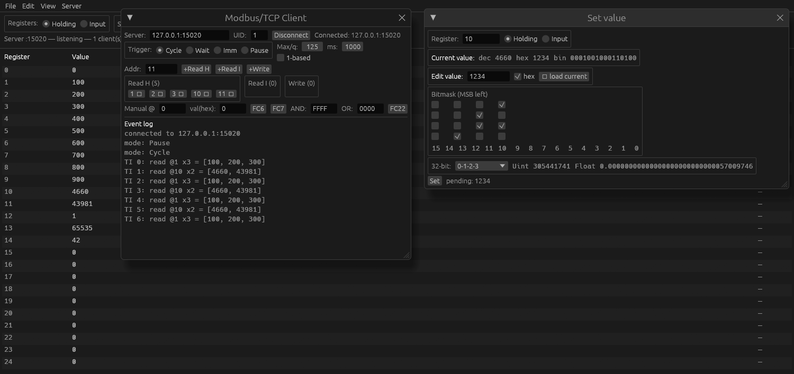

<div align="center">


# Ananasar

**A Modbus/TCP client and server, written in Rust.**<br>
A port of Ananas, the free Modbus/TCP test tool by Tuomio, built with [REA](https://rea.tools/) as a hands-on look at what AI-assisted development can do today.

[](https://github.com/andy778/ananasar/actions/workflows/build.yml)
[](https://github.com/andy778/ananasar/releases/latest)
[](https://github.com/andy778/ananasar/releases)
[](LICENSE)
[](https://securityscorecards.dev/viewer/?uri=github.com/andy778/ananasar)

[Download](#download) · [Quick start](#quick-start) · [Build](#build-from-source) · [Layout](#project-layout)



<sub>The register list, the live Server status panel with a client polling, and the Logging controls.</sub>

</div>

## Features

- **Server** answering function codes 3, 4, 6, 16, 22 and 23, with proper exception responses and unit-id filtering. Two clients at a time, as in the original.
- **Server data log** (CLI: `--log-dir`, `--interpretive`; GUI: the Logging panel with start/stop and a packet count): every request and reply per connection, as hex or with decoded descriptions, plus detected errors.
- **Client** poll engine: sorted address lists, consecutive addresses merged into as few queries as possible, Cycle / Wait / Immediate trigger modes and manual FC6 / FC22 / FC7 commands.
- **One shared register model** (holding and input, 65 536 registers each) used by the server, the client and the editors.
- **Server status panel** like the original's: per-client IP, poll interval, last request fields, traffic totals and error flags, live.
- **Register list** with hex display, inline editing and a **bit editor** with 32-bit Uint/Float views.
- **Register scanner**: `ananasar scan host:port --start 0 --end 99` reads a range one register at a time and reports which answer. The GUI has the same sweep under View → Scanner, with a results table and a stoppable run.
- **Save / load** register values as `*.ananas` text files (File → Open… / Save…, or `ananasar server --load FILE`).
- **Headless CLI** for scripting, built on the same engine.

## Download

Prebuilt binaries are attached to every [release](https://github.com/andy778/ananasar/releases/latest):

| Platform | Files |
| --- | --- |
| Windows x64 | `ananasar.exe` (CLI), `ananasar-gui.exe` (GUI) |
| macOS (Apple silicon + Intel) | `ananasar-macos-universal.tar.gz` |
| Linux x86_64 | `ananasar-linux-x86_64.tar.gz` |

The macOS build is unsigned, so Gatekeeper blocks it on first run. Clear the quarantine flag after extracting:

```bash
tar xzf ananasar-macos-universal.tar.gz
xattr -dr com.apple.quarantine ananasar ananasar-gui
./ananasar-gui
```

The Windows executables are not code-signed either, so Windows SmartScreen may warn the first time you run them ("More info" → "Run anyway").

### Verify a download

Every release file is signed with [cosign](https://github.com/sigstore/cosign) (keyless, from the release workflow); the signature is the matching `.sigstore.json` file on the release page:

```bash
cosign verify-blob \
  --bundle ananasar-linux-x86_64.tar.gz.sigstore.json \
  --certificate-identity-regexp '^https://github.com/andy778/ananasar/\.github/workflows/build\.yml@refs/tags/v' \
  --certificate-oidc-issuer https://token.actions.githubusercontent.com \
  ananasar-linux-x86_64.tar.gz
```

The binaries are built with [cargo-auditable](https://github.com/rust-secure-code/cargo-auditable), so their dependency list is embedded and can be checked for known vulnerabilities with `cargo audit bin ananasar`.

*Signatures and embedded audit data start with the first release made after they were added; older releases (v0.1.x) have neither.*

## Quick start

Run the GUI (`ananasar-gui`). It starts a server on port 15020; open **View → Client window** to poll it, or point the client at any other Modbus/TCP device.

Or use the headless CLI:

```bash
# server (port 502 needs root, so use a high port)
ananasar server --port 15020

# client: poll holding registers, or write a block
ananasar client 127.0.0.1:15020 --read-holding 10,11,12,100 -n 4
ananasar client 127.0.0.1:15020 --write 42,43,44 -n 1

# server with a data log (add --interpretive for decoded entries)
ananasar server --port 15020 --log-dir logs
```

The log file is named `ananasar-<port>-<UTC time>.log`; each entry is numbered and shows the elapsed milliseconds, the connection (1 or 2), the query and the reply.

Run `ananasar --help` or `ananasar client --help` for every option. Shell completions: `ananasar completions bash` (also zsh, fish, powershell, elvish).

## Build from source

Needs Rust 1.92 for the core and CLI, and 1.95 for the GUI (egui 0.36).

```bash
cargo build --release      # binaries in target/release/
cargo test                 # protocol and optimizer tests
```

The parsers that read network input are also fuzzed (`cargo +nightly fuzz run frame` from the repository root, using [cargo-fuzz](https://github.com/rust-fuzz/cargo-fuzz)). CI builds and releases the Windows, macOS and Linux binaries.

## Project layout

- [`crates/ananasar-core`](crates/ananasar-core): `std`-only, I/O-free protocol engine
  - `protocol`: MBAP framing, function and exception codes
  - `registers`: the shared register model
  - `server`: request validation and dispatch
  - `log`: raw and interpretive log entry formatting
  - `client`: the poll engine and query builders
- [`crates/ananasar-cli`](crates/ananasar-cli): the headless `ananasar` binary
- [`crates/ananasar-gui`](crates/ananasar-gui): the egui application (`ananasar-gui`)
- [`fuzz`](fuzz): cargo-fuzz targets for the frame parser and the server handler

## Design notes

- The server and client share one register file, as the original does.
- The optimizer only merges addresses that are already consecutive in the sorted list, capped by the max-per-query setting, matching the original's greedy coalescing.
- **Intentional fix:** the original validated only `start + count <= 65536` and built FC3/FC4 replies in a fixed 513-byte buffer, so quantities of 253–255 overflowed it. This port enforces the Modbus limits (125 read / 123 write) and returns `IllegalDataValue` instead.

## Not yet implemented

The Windows-only DDE and network-adapter features (not planned).

## About the original

Ananas is a free Modbus/TCP test tool written by Tuomio. The program was distributed from `http://www.tuomio.fi/ananas/`, which no longer exists. Ananasar is an independent reimplementation: it contains no code from the original, and the original program is not included here.

## License

[MIT](LICENSE). Ananasar is provided as is; see [SECURITY.md](SECURITY.md).
